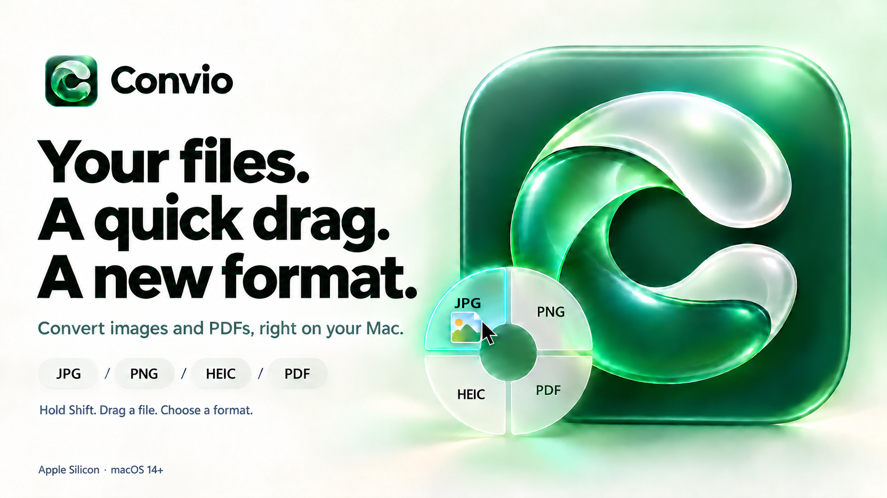

# Convio



A local image and PDF converter for Apple Silicon Macs running macOS 14 or later.

Convio is the new product name. Users of the previous app identity must quit the old app and install Convio manually once; future Convio updates use the menu bar updater.

Version 0.4.7 introduces the Convio name across the app, installer, and banners. The raster master and macOS icon are in `Source/Assets/`; the build script installs the icon automatically.

## Use

### Install from Terminal

On an Apple Silicon Mac running macOS 14 or later, paste:

```sh
curl -fsSL https://github.com/byhaqii/Convio/releases/latest/download/install.sh | /bin/bash
```

This downloads the compiled app, checks its SHA-256 and signature, and installs it in `~/Applications`. No Xcode or sudo is needed. Open Convio from that folder. To upgrade an older installation, quit Convio first and run the same command; the previous app is backed up before replacement.

The app is ad-hoc signed and not notarized. If macOS blocks it, approve it in **System Settings → Privacy & Security → Open Anyway**.

### Updates

Convio checks GitHub Releases at launch and every 24 hours while running. Open the menu bar icon for **Check for Updates…** or **Update & Restart** when a newer release is available. Installation requires confirmation and waits until no conversion is running. Restarting clears the window's file list; original files and conversion results are preserved.

Version 0.4.2 and earlier require the Terminal command above once to gain in-app updating. The app must be installed in a writable folder; updating an administrator-owned installation may require moving it to `~/Applications` first.

Updates validate the GitHub asset checksum, bundle identity/version, macOS compatibility, architecture, and code signature before replacement. Downloads trust HTTPS and the `byhaqii/Convio` repository; ad-hoc signing does not verify publisher identity. No Gatekeeper protections are bypassed. The previous app and `update.log` remain in a hidden `.Convio-update-*` folder beside the installed app for recovery. A replacement or launch-command failure restores the previous app; a later app crash is not automatically detected.

Open **Convio.app**. Convio runs in the background with a circular-arrows icon in the macOS menu bar and no Dock icon. Click the icon for **Open Convio**, **Open Wheel**, or **Quit Convio**. Closing the converter window keeps Convio running; opening it again preserves the current file list. Convio does not automatically start at login.

Launching another copy activates the existing Convio instead of starting another drag monitor. If older copies are already running from different folders, quit all of them once, then launch only the updated installation in `~/Applications`.

Hold **Shift** while dragging a file in Finder, then drop it onto JPG, PNG, HEIC, or PDF. The rounded glass wheel appears near the pointer. Results are saved beside the source with a new name; originals and existing files are never overwritten.

You can also choose files, output format, quality, and destination in the main window. **Buka roda** opens the wheel manually. Escape closes it.

- PDF-to-image exports every page separately at 144 DPI, with numbered filenames.
- Image-to-PDF creates one PDF per image.
- The wheel uses 85% quality for JPG/HEIC. It appears over 180 ms and shrinks away over 120 ms immediately after conversion. Reduce Motion uses an 80 ms fade.
- macOS 26 uses native Liquid Glass. Earlier supported macOS versions use frosted material.
- Conversion stays local. No accounts, file uploads, analytics, or Homebrew dependencies. Update checks contact GitHub, and installing an update downloads its release ZIP.

## Limits

Animated images, locked PDFs, and PDF-to-PDF conversion are rejected. Images/pages are limited to 80 megapixels and 20,000 pixels per side. Metadata is not copied; orientation is applied to pixels. JPG uses a white background for transparency. Color/HDR and quality can change during conversion.

The app is locally ad-hoc signed, not Apple-notarized. Intel Macs and older macOS releases have not been tested.

Quit the old Berkas app before opening Convio so that only one Shift-drag wheel runs.

## Build

Requires the Swift 6.2 toolchain and macOS 26 SDK, supplied by Xcode 26.

```sh
bash Source/build.sh
```

## Test

```sh
swiftc -swift-version 6 -parse-as-library Source/Converter.swift Source/DragWheel.swift Source/Tests.swift -o /tmp/convio-tests
/tmp/convio-tests
```

Update checks and isolated replacement tests:

```sh
swiftc -module-cache-path /tmp/convio-module-cache -swift-version 6 -parse-as-library Source/UpdateRelease.swift Source/UpdateValidation.swift Source/UpdateTests.swift -o /tmp/convio-update-tests
/tmp/convio-update-tests
python3 Source/test-update.py
python3 Source/test-install.py /path/to/Convio-0.4.7-arm64.zip
swiftc -module-cache-path /tmp/convio-module-cache -swift-version 6 -parse-as-library Source/InstanceLock.swift Source/InstanceTests.swift -o /tmp/convio-instance-tests
/tmp/convio-instance-tests
```

The helper test replaces fixture directories and mocks the macOS launcher; it does not prove a real app restart. The installer test uses the supplied release archive, an isolated home folder, and mocked download/launch commands.

Use `--skip-heic` when running tests in environments that block the hardware encoder. HEIC was tested through the previous app build on this Mac.

Version 0.4 verification: build and local signature passed; conversion, multi-page PDF, original-file protection, duplicate names, EXIF orientation, invalid input, and rounded-sector hit tests passed. The Convio name, rounded wheel, and Escape dismissal were checked in the running app. Other Macs and frame-by-frame animation timing were not checked.

## GitHub

Source is hosted at [byhaqii/Convio](https://github.com/byhaqii/Convio). Compiled downloads and the installer are available in [Releases](https://github.com/byhaqii/Convio/releases). Build outputs are ignored.

For future updates, use a stable `vMAJOR.MINOR.PATCH` tag matching `CFBundleShortVersionString`, upload `Convio-MAJOR.MINOR.PATCH-arm64.zip` containing `Convio.app`, and attach the matching `install.sh`. The executable is `Convio` and the bundle ID is `com.shustle.convio`. Set the installer checksum from the newly built archive before publishing. GitHub supplies the asset digest used by the in-app updater.
